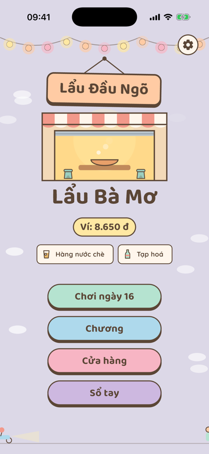
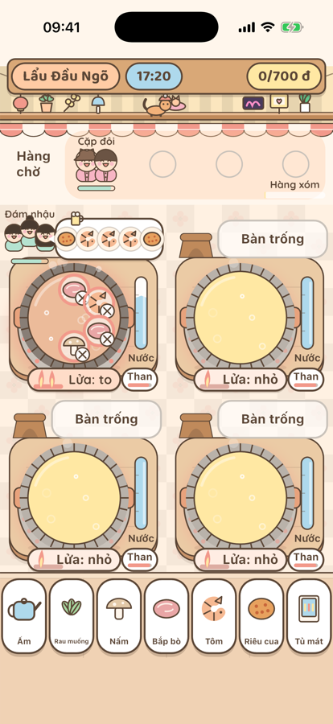
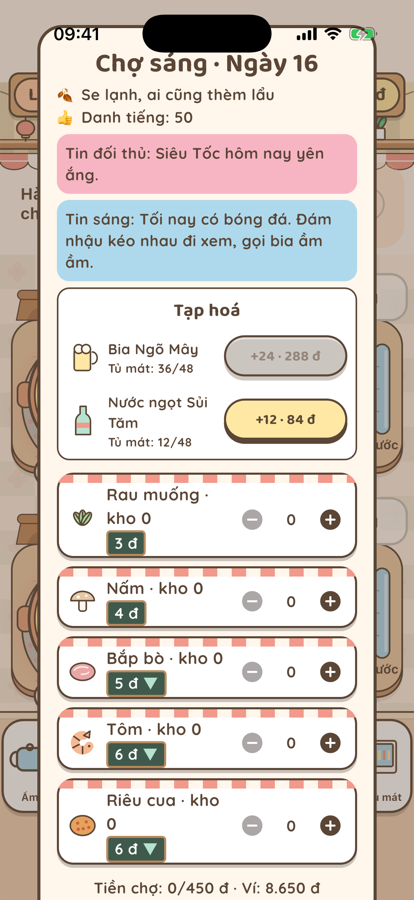
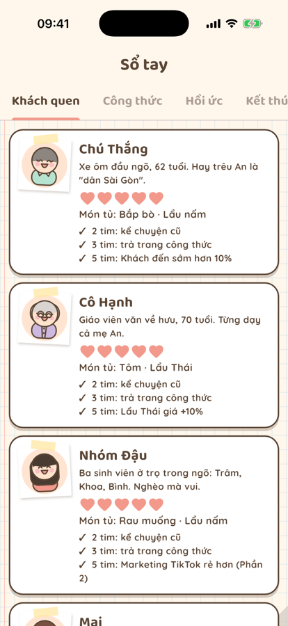

# Lẩu Bà Mơ

Bà Mơ có một quán lẩu nhỏ đầu ngõ. Nồi nước dùng còn sôi, khách đã xếp hàng. Bạn giúp bà từ chiếc nồi đầu tiên đến cả một chuỗi quán trên bản đồ Hà Nội.

- Nhúng lẩu, nướng, bưng ra đúng bàn, đúng lúc.
- Sáng đi chợ, tối đếm hoá đơn, ghi sổ tay khách quen.
- Nâng cấp bếp, trang trí quán, mở chi nhánh, đấu với quán đối diện.
- Chơi một mình, không cần mạng, không cần tài khoản. Có tiếng Việt và tiếng Anh.

  
  
  
  

Dành cho iPhone, phát hành trên App Store.

[Hỗ trợ](support.html) · [Chính sách quyền riêng tư](privacy.html)

---

## English

**Lẩu Bà Mơ (Grandma Mơ's Hotpot)** is a cozy game about a tiny hotpot shop at the mouth of a Hanoi alley. Cook, serve and grow from one pot to a chain of shops. Single-player, offline, no account needed. Available in Vietnamese and English on the App Store for iPhone.

[Support](support.html) · [Privacy Policy](privacy.html)
